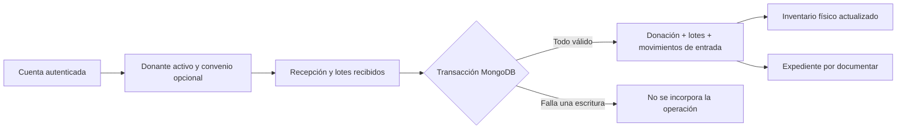

# Etapa 3: registros y catálogos

Actualizado el 27 de noviembre de 2026.

Esta etapa incorpora datos operativos reales desde los formularios. No requiere ejecutar scripts en
Compass o mongosh: utiliza las ocho colecciones, validadores e índices de la migración V2.
Las fotografías, PDF y revisión administrativa están implementadas en la [etapa 5](08-evidencias-y-revision.md).

## Uso de la aplicación

### Donantes y organizaciones

1. Entra a **Catálogos** y busca el nombre antes de crear un registro.
2. En **Donantes → Nuevo donante**, registra una persona, empresa, mercado o productor. Para una
   persona ocasional basta el nombre y tipo; NIT, dirección y contacto son opcionales. No exige convenio.
3. En **Organizaciones → Nueva organización**, registra tipo, dirección, zona o barrio, responsable,
   teléfono y población. La suma de niños y adultos mayores no puede exceder el total.
4. **Editar** actualiza el contacto y la disponibilidad. Desactivar impide nuevas operaciones, pero
   conserva los datos anteriores y las donaciones que ya se registraron.

La zona de una organización es su barrio o área geográfica. Las zonas Z1–Z4 pertenecen al almacén.
Los nombres de las contrapartes guardados en donaciones anteriores se conservan como referencia histórica.

### Convenios

**Catálogos → Convenios → Nuevo convenio** registra el donante activo, nombre, vigencia y condiciones.
Periodicidad y fin de vigencia son opcionales; no se inventa una frecuencia de donación.

**Nueva versión** conserva el mismo código y aumenta la versión. Debe partir de la última versión y
no puede comenzar antes de ella. La anterior permanece intacta; las donaciones históricas siguen
vinculadas a su identificador original. El PDF aparece pendiente hasta incorporar la carga de archivos.

En una recepción se verifica que el convenio pertenezca al donante y sea la última versión de ese
acuerdo cuyo inicio ya haya ocurrido. Además, su vigencia debe cubrir la fecha de recepción.
Una versión futura no sustituye anticipadamente a la actual. Registrar una recepción histórica permite
usar la versión que correspondía entonces. No se cambia retroactivamente el convenio de una donación.

### Registrar una recepción

1. Entra a **Donaciones → Registrar recepción**.
2. Busca y selecciona un donante activo. Si es nuevo, usa el enlace para registrarlo en otra pestaña;
   al volver, busca su nombre para actualizar los resultados.
3. Indica la fecha y hora de recepción en Bolivia. Debe ser un hecho ya ocurrido. El responsable del
   registro es automáticamente la cuenta autenticada y no se puede elegir otra persona.
4. Selecciona el convenio aplicable o deja **Sin convenio / donación ocasional**.
5. Añade de 1 a 30 lotes, separados por producto, vencimiento y conservación. Cada lote conserva
   cantidad y unidad propias: por ejemplo, 100 bolsas y 20 cajas no se suman como una cantidad única.
6. Completa zona, conservación y vencimiento cuando conste. El peso opcional corresponde a todo el
   lote, en kg. Se admiten hasta tres decimales. Marca y código del fabricante son opcionales.
7. Revisa y confirma la recepción. Se abre la ficha guardada con estado **Por documentar**.

Zonas: **Z1 secos**, **Z2 panificados**, **Z3 refrigerados**, **Z4 no alimentos**. Los productos que
requieren refrigeración deben ir a Z3; limpieza debe ir a Z4; los alimentos no pueden ir a Z4.
No se calculan capacidades físicas ni se incorpora un mapa. Un lote ya vencido se conserva como
**vencido**, nunca como disponible para repartir. Si el vencimiento no consta, se deja sin registrar.

Al confirmar, `cantidadEnBodega` y su alias compatible `cantidadDisponible` reciben la cantidad
ingresada; `cantidadReservada` comienza en cero. Cada lote tiene un movimiento de tipo `recepcion`.
El peso total de la donación solo se calcula si todos los lotes tienen peso medido.

El estado documental no determina el saldo físico. La recepción ya ocurrió aunque falten fotos.
Administración verá la nueva donación pendiente; la aprobación no se inventa ni ocurre automáticamente.

Si se pierde la confirmación del servidor, el formulario conserva el envío exacto y permite
**Reintentar recepción**. La misma solicitud devuelve el registro existente sin aumentar existencias.
No cierres ni recargues el formulario antes de resolver ese reintento. Si ya lo cerraste, busca la
donación antes de abrir un formulario nuevo: un nuevo formulario representa otra operación.

### Equipo y accesos

Solo administración ve **Equipo**. Puede crear una cuenta o editar las cuentas existentes.
Para habilitar una que aparece **Sin contraseña**, abre **Editar**, completa una contraseña inicial
de 15–128 caracteres y verifica que esté activa. Comunícala al titular por el medio acordado;
la aplicación no envía correos ni mensajes. El titular podrá cambiarla en **Mi cuenta**.

Las contraseñas se guardan con Argon2id. Las cuentas que ya tienen contraseña no permiten reemplazarla
desde este formulario. Cambiar el rol o desactivar revoca las sesiones de esa cuenta. El administrador
no puede desactivarse ni quitarse a sí mismo su rol; las acciones concurrentes se vuelven a autorizar
dentro de la transacción. La contraseña administradora existente no fue modificada.

## Permisos

| Acción | Voluntariado | Coordinación | Administración |
| --- | --- | --- | --- |
| Consultar donantes, organizaciones y convenios | Sí | Sí | Sí |
| Crear persona donante activa | Sí | Sí | Sí |
| Crear otros tipos de donante / editar donantes | No | Sí | Sí |
| Crear / editar organizaciones | No | Sí | Sí |
| Crear versiones de convenio | No | Sí | Sí |
| Registrar recepción | Sí | Sí | Sí |
| Consultar operaciones | Autoría propia | Autoría propia | Todas |
| Consultar / crear / editar cuentas | No | No | Sí |

La restricción se verifica en el servidor y también dentro de la transacción; ocultar botones no
constituye la protección. Los cambios de datos requieren `Origin` permitido y sesión activa.

## Contrato técnico implementado

Las altas (`POST`) requieren `claveOperacion`, un UUID generado una vez por formulario. El servidor
asocia la clave con el usuario y el tipo de operación. Los códigos internos se generan sin contadores
basados en el número de documentos; son únicos y no se introducen manualmente.

| Ruta | Cuerpo de escritura |
| --- | --- |
| `POST /api/donantes` | `claveOperacion`, `nombre`, `tipo`, `activo`, `contacto`; `nit` y `direccion` opcionales. |
| `PATCH /api/donantes/:id` | Datos completos del formulario y `versionDatos` leída. Los opcionales omitidos se vacían. |
| `POST /api/organizaciones` | `claveOperacion`, `nombre`, `tipo`, `direccion`, `zona`, `responsable`, `poblacion`, `activa`. |
| `PATCH /api/organizaciones/:id` | Los mismos datos, con `versionDatos` en lugar de la clave de alta. |
| `POST /api/convenios` | `claveOperacion`, `donanteId`, `nombre`, `desde`, `condiciones`; `hasta`, `periodicidad` y `anteriorId` opcionales. |
| `POST /api/donaciones` | `claveOperacion`, `donanteId`, `fechaRecepcion`, `lotes[]`; `convenioId` y `observaciones` opcionales. |
| `POST /api/usuarios` | `claveOperacion`, `nombre`, `email`, `telefono`, `rol`, `activo`, `passwordInicial`. |
| `PATCH /api/usuarios/:id` | Datos completos, `versionDatos` y `passwordInicial` solo para habilitar una cuenta sin hash. |

Los catálogos y cuentas tienen `GET` de lista y ficha. Listas: `q` literal de hasta 80 caracteres,
`pagina` de 1 a 9999 y `activo=si|no` en catálogos con disponibilidad. Convenios admite `donanteId`.
Cada página devuelve 20 resultados. Usuarios publica un booleano `tieneAcceso`, jamás el hash.

Cada lote recibe `producto`, `categoria`, `cantidad`, `unidad`, `zona` y `conservacion`;
`fechaVencimiento`, `pesoKg`, `marca` y `codigoLote` son opcionales. La API rechaza campos de autor,
saldo, aprobación, archivos o estado enviados por el cliente. Se limita el JSON a 64 KiB para
recepciones y 16 KiB para los demás registros; autenticación mantiene su límite de 8 KiB.

Las fechas de convenio y vencimiento usan `YYYY-MM-DD`, con fin de día inclusivo en Bolivia.
La recepción usa `YYYY-MM-DDTHH:mm`, interpretada en UTC−04:00. MongoDB guarda objetos `Date`.

Respuestas: `201` creación, `200` edición o reintento confirmado, `400` datos inválidos,
`401` sesión ausente, `403` rol/origen prohibido, `404` ficha inexistente, `409` conflicto de versión,
correo o clave de operación y `503` indisponibilidad. Todas usan `Cache-Control: no-store`.

## Campos técnicos adicionales

Son opcionales para los registros históricos y compatibles con los validadores V2 actuales.
No se agregan colecciones ni se ejecuta un reemplazo masivo de documentos.

| Campo | Ubicación y propósito |
| --- | --- |
| `registradaPor`, `registradaEn`, `historial[]` | Nuevos catálogos y cuentas: quién creó o modificó el registro y cuándo. En donaciones se mantienen las reglas V2. |
| `versionDatos`, `actualizadaEn` | Catálogos editables y cuentas: detectar formularios desactualizados. Un histórico sin versión se lee como 0. |
| `claveOperacion`, `solicitudHash` | Altas: reconocer el mismo envío y rechazar reutilizarlo con otro contenido. La huella de cuentas excluye la contraseña; reintentar su alta no cambia la clave ya establecida. |
| `versionAcciones` | `voluntarios`: contador interno usado al autorizar una escritura; coordina cambios de permisos concurrentes. No es el número de donaciones. |
| `versionUso` | `donantes`: coordina su disponibilidad con nuevas recepciones y versiones de convenios. No sustituye el historial de donaciones. |
| `anteriorId` | Versión de convenio que dio origen a una nueva; las referencias históricas se conservan. |
| `registradaEn` | Movimiento de recepción: instante en que se registró, separado de `fecha`, el momento del hecho físico. |

Las operaciones relacionadas se ejecutan secuencialmente dentro de `withTransaction`, con lectura
snapshot y confirmación majority. La transacción guarda todos los documentos o ninguno, y los
índices únicos respaldan los reintentos y la numeración de versiones.
[Documentación del controlador de MongoDB](https://www.mongodb.com/docs/drivers/node/current/crud/transactions/).

## Verificación de esta entrega

- 51 pruebas locales de autenticación, consultas, validación y migración.
- 10 escenarios de integración de escritura con los validadores V2 y una base temporal de Atlas:
  permisos, recepción simultánea, reversión ante fallo, estado de lotes vencidos, vigencia/versiones,
  conflictos de edición, contraseñas, revocación de sesiones y cambios administrativos concurrentes.
- Compilación, TypeScript y ESLint; revisión de formularios en escritorio y ancho móvil de 393 px.

`npm run test:integration` crea una base con nombre `bab_test_<identificador aleatorio>` y retira
únicamente sus colecciones al terminar. No usa `seed.js` ni escribe datos de prueba en `bab_donaciones`.
La conexión de pruebas necesita permisos de creación, lectura y escritura sobre la base temporal.

La etapa 4 incorpora inventario por zonas, FEFO, reservas, programación y confirmación de
entregas, mermas y devoluciones: [guía de uso](07-inventario-y-entregas.md). El registro de fotos, PDF y aprobación administrativa está
disponible en la [etapa 5](08-evidencias-y-revision.md). Los manuales finales y el modelo Word se consolidan en la etapa 6.
