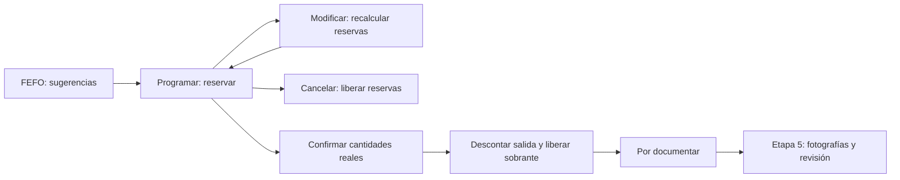

# Etapa 4: inventario y entregas

Actualizado el 27 de noviembre de 2026.

Esta etapa conecta los productos recibidos con su distribución real. No requiere otra migración:
utiliza el modelo V2 instalado, con campos de auditoría adicionales admitidos por sus validadores.
No ejecutes `seed.js` ni vuelvas a aplicar la migración para habilitar estas pantallas.

## Recorrido de uso

1. Abre **Inventario**. Puedes filtrar por producto, código, marca, zona y estado. La ficha del lote
   muestra saldo físico, reservado, libre, reservas activas y movimientos con sus responsables.
2. Selecciona **Sugerencias FEFO** para ver primero los lotes que vencen antes. Puedes indicar la
   fecha prevista; se excluyen los que vencerían antes. Los lotes sin fecha aparecen al final y se
   identifican expresamente. Una sugerencia no crea una entrega ni reserva productos.
3. Como coordinador o administrador, pulsa **Programar entrega**. Elige una organización activa,
   responsable, fecha, lugar y cantidades por lote. Al guardar se comprueba de nuevo el saldo libre.
4. Abre la ficha. **Modificar programación** recalcula las reservas y exige un motivo.
   **Cancelar entrega** libera todas las reservas sin cambiar el saldo físico. Las fechas atrasadas
   se señalan; no cancelan reservas automáticamente.
5. Cuando la entrega ocurra, su responsable o coordinación abre **Confirmar entrega**. Registra
   fecha real, persona receptora, lugar, atenciones y cantidades efectivamente entregadas.
   Se admite menos de lo reservado e incluso cero en una línea, pero debe haber alguna salida real.
6. La entrega queda **por documentar**. El autor de la programación y la persona que confirmó
   quedan separados. La confirmación descuenta una vez y libera cualquier reserva sobrante.

No se mezclan cantidades de bolsas, cajas u otras unidades. El peso por línea es opcional y debe
ser medido: solo se publica peso total si todas las líneas con salida tienen peso registrado.
Las atenciones no equivalen a personas únicas. Las cuatro zonas no tienen capacidades inventadas.

### Ejemplo: 200 bolsas

| Acción | En bodega | Reservado | Libre |
| --- | ---: | ---: | ---: |
| Recepción | 200 | 0 | 200 |
| Programar entrega A por 100 | 200 | 100 | 100 |
| Intentar otra entrega por 120 | 200 | 100 | 100 |
| Confirmar que A entregó 80 | 120 | 0 | 120 |

La segunda programación se rechaza completa. Las 20 bolsas que A no entregó quedan libres.
Si persiste un compromiso de entregarlas después, se crea otra programación; no se vuelve a
confirmar la anterior. Reintentar el mismo envío no duplica reservas ni salidas.

## Mermas, devoluciones y correcciones

Se registran desde **Inventario → Ver lote → Registrar movimiento**, con cantidad, motivo y
responsable tomado de la sesión. Los movimientos no se eliminan.

| Movimiento | Efecto | Referencia necesaria |
| --- | --- | --- |
| Merma | Reduce existencias por pérdida o retiro. | Motivo; si afecta reservas, entregas a reducir. |
| Devolución recibida | Reincorpora productos aptos que salieron en una entrega. | Movimiento de salida de esa entrega y lote. |
| Devolución al donante | Retira productos previamente recibidos. | Movimiento de recepción del mismo lote. |
| Corrección de entrada | Suma existencias para compensar un registro erróneo. | Recepción, entrega o merma original; solo administración. |
| Corrección de salida | Resta existencias para compensar un registro erróneo. | Recepción, entrega o merma original; solo administración. |

Para un retorno recibido debe declararse si es apto para reincorporarse. Si no lo es, se registran
su devolución y su merma juntas, sin aumentar el saldo disponible. Este prototipo no incluye un
depósito de cuarentena. Un lote vencido o descartado no puede reincorporarse como apto.

Una devolución acumulada no puede superar la cantidad original corregida. Tampoco puede
corregirse el original por debajo de lo ya devuelto. Los ajustes no encadenan ajustes: se refieren
al movimiento original. El historial y la ficha de entrega muestran cantidad original, corregida,
devuelta y neta; cada unidad se conserva por lote.

Si una merma deja el saldo por debajo de lo reservado, el formulario permite elegir cuánto liberar
de cada entrega. Todo se guarda junto: pérdida, reserva y aviso **requiere reasignación**. La cantidad
prevista original se conserva. Coordinación debe modificar el plan o cancelarlo antes de confirmar.
Por ejemplo, con 200 unidades y 140 reservadas, una merma de 100 necesita liberar al menos 40.

Las correcciones de recepción o entrega aumentan la versión del expediente y quedan en su historial.
Un registro pendiente de revisión vuelve a **por documentar**; uno observado conserva la observación.
Si estaba completado, necesita reapertura administrativa, disponible en la etapa 5. No se aprueban
correcciones automáticamente. Una devolución real posterior no altera la certificación del hecho original.

## Permisos

| Acción | Voluntariado | Coordinación | Administración |
| --- | --- | --- | --- |
| Consultar inventario y movimientos | Sí | Sí | Sí |
| Consultar entregas | Propias, asignadas o realizadas | Todas | Todas |
| Programar, modificar o cancelar | No | Sí | Sí |
| Confirmar salida | Propia o asignada | Sí | Sí |
| Registrar merma o devolución | No | Sí | Sí |
| Corregir una cantidad mediante ajuste | No | No | Sí |

El inventario informa el total reservado por el equipo. Los enlaces y detalles de expedientes
respetan el alcance de cada cuenta. Las recepciones siguen limitadas al autor salvo administración.
Un campo histórico `entregadaPor` sin fecha real no acredita participación en una entrega realizada.
Los permisos se comprueban otra vez dentro de cada transacción; una cuenta desactivada o con
un rol cambiado no puede seguir escribiendo con permisos antiguos.

## API y consistencia

Todas las rutas requieren sesión; las escrituras exigen además origen válido y JSON limitado.

| Ruta | Datos principales |
| --- | --- |
| `GET /api/lotes` | `q`, `zona`, `estado`, `pagina`. 20 lotes por página. |
| `GET /api/lotes/:id` | Lote, reservas visibles, conciliación y movimientos paginados. |
| `GET /api/sugerencias-fefo` | `q`, `zona`, `fecha` prevista local, `pagina`; 20 sugerencias. |
| `GET /api/responsables` | Identificador, nombre y rol de cuentas activas; gestores. |
| `POST /api/entregas` | Organización, responsable previsto, fecha, lugar, atenciones previstas e `items[{loteId,cantidad}]`. |
| `PATCH /api/entregas/:id` | Plan completo, `versionDatos` y motivo. |
| `POST /api/entregas/:id/cancelar` | `versionDatos` y motivo. |
| `POST /api/entregas/:id/confirmar` | `versionDatos`, fecha real, receptor, lugar, atenciones e items reales; peso opcional. |
| `GET /api/movimientos` | `loteId` obligatorio y `pagina`; historial del lote. |
| `POST /api/movimientos` | Lote, tipo, cantidad y motivo; origen, aptitud y reducciones según el tipo. |

Cada escritura incluye `claveOperacion` UUID. La misma clave y contenido devuelven el resultado
ya guardado; reutilizarla para datos diferentes devuelve 409. Las ediciones también incluyen versión.
Las cantidades admiten tres decimales, máximo un millón por lote y operación; una entrega admite
1–30 lotes. Se unifican lotes repetidos al programar; al confirmar se exige una línea por lote previsto.
El historial muestra 20 movimientos por página, hasta 100 reservas por lote y hasta 500 cuentas
activas en el selector. Estos límites corresponden al alcance del prototipo.

Las fechas de formularios son locales de Bolivia, `YYYY-MM-DDTHH:mm`, y se almacenan como Date UTC.
No se entrega antes de recibir ni se confirma una fecha futura. La aptitud se vuelve a comprobar
al confirmar, incluso si se registra una entrega pasada: un lote vencido hoy requiere revisión y
no se confirma automáticamente. Las existencias y reservas deben mantenerse no negativas.

Se usa una transacción MongoDB por acción, con operaciones secuenciales, lectura snapshot y
confirmación majority. El documento del lote coordina escrituras concurrentes. Al fallar una parte,
se revierten reservas, movimientos, expediente y auditoría de esa acción.

## Campos añadidos sin reemplazar el modelo V2

| Campo | Propósito |
| --- | --- |
| `entregas.requiereReasignacion` | Una reducción de reserva exige ajustar el plan antes de confirmar. |
| `lotes.versionInventario` | Contador de cambios de saldo; no es una cantidad de producto. |
| `organizaciones.versionUso` | Coordina disponibilidad de la organización con nuevas programaciones. |
| `voluntarios.versionAsignaciones` | Coordina asignación con activación y cambios de cuenta. |
| `solicitudHash`, `claveOperacion` | Identifican un mismo envío y su contenido. |
| `historial[].claveOperacion`, `solicitudHash` | Reintentos de modificación, cancelación y confirmación. |
| `movimientos.registradaEn` | Momento de registrar, separado de la fecha del hecho. |
| `movimientos.reincorporar` | Condición del retorno recibido. |
| `movimientos.reducciones[]` | Entregas y cantidades cuya reserva se liberó por una salida. |
| `historial[].movimientoId`, `revisionAnterior` | Vinculan una corrección y conservan la revisión anterior. |

`cantidadDisponible` continúa como alias de `cantidadEnBodega` para compatibilidad. No representa
lo libre. Lo libre se calcula restando `cantidadReservada`. La conciliación compara movimientos
con saldo físico y programaciones con reservas. Si existen diferencias por cambios externos,
la ficha las señala para revisión; no las corrige silenciosamente.

## Validación y siguiente etapa

Las pruebas locales cubren validación, fechas, decimales, permisos y proyección de correcciones.
Resultado de esta entrega: 59 pruebas locales y 25 escenarios de integración aprobados; compilación,
TypeScript y ESLint correctos. Se comprobaron 30 condiciones HTTP de sesión y origen y 75 condiciones
de lectura de la base del proyecto, conservando sus datos. Se revisó el inventario y FEFO en escritorio.
La integración crea bases `bab_test_<id>` con validadores e índices V2, prueba transacciones reales,
y retira únicamente sus colecciones. Incluye sobreventa concurrente, reintentos, reversión ante fallo,
entregas parciales, vencimiento, mermas que afectan reservas, devoluciones y ajustes con origen.

La etapa 5 incorpora subida, consulta y descarga de fotos y PDF, y el circuito administrativo de
revisión, observación, reenvío y reapertura. La etapa 6 consolida informes, manuales y Word de diseño.
