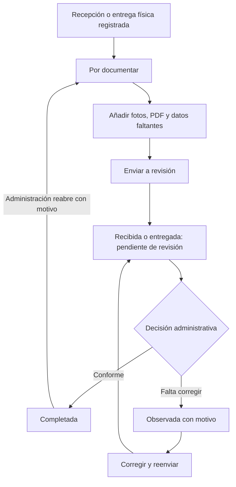

# Etapa 5: evidencias y revisión administrativa

Actualizado el 27 de noviembre de 2026.

La aplicación guarda fotografías y PDF originales en GridFS, permite consultarlos y descargarlos
con sesión, y vincula cada archivo a una sola donación, entrega o versión de convenio.
La recepción y la salida física conservan el funcionamiento de la etapa 4.

## Usar el expediente

1. Abre **Donaciones** o **Entregas** y entra en **Información**.
2. En **Documentos y fotografías**, selecciona un archivo, describe qué muestra y pulsa **Guardar archivo**.
   En una recepción puedes señalar el lote fotografiado. Repite la carga para las demás evidencias.
3. Comprueba las cantidades, el responsable, las fechas y los archivos. **Abrir foto/PDF** muestra el
   original en otra pestaña; **Descargar** lo guarda en el equipo. Ambos requieren sesión y acceso al expediente.
4. En **Presentación y revisión del expediente**, resuelve los pendientes y pulsa **Enviar a revisión**.
5. Administración abre el pendiente desde el panel, revisa los datos y las evidencias, marca la
   confirmación manual y elige **Aprobar y completar** o **Solicitar correcciones**.
6. Si hay observaciones, el responsable ve el motivo y puede corregir información o evidencias.
   Después vuelve a enviar la operación para otra revisión.

Las fotos no aprueban automáticamente la operación. Subir archivos a una entrega programada
tampoco confirma su salida: primero se registra la entrega física mediante sus acciones.



En estos pasos documentales no se crean movimientos, no se liberan reservas y no se descuentan
productos. Una entrega parcial, devolución, merma o corrección de cantidades utiliza la
[gestión de inventario](07-inventario-y-entregas.md).

## Fotos, documentos y convenios

| Regla | Comportamiento |
| --- | --- |
| Evidencia mínima | Una fotografía válida de la propia recepción o entrega. Un PDF o una foto ajena no cumplen esta condición. |
| Tipos | JPEG, PNG, WebP y PDF. El servidor verifica contenido y determina extensión/MIME; no confía en el nombre ni en el tipo declarado por el navegador. |
| Tamaño | Hasta 10 MiB por archivo (la interfaz lo expresa como 10 MB), 20 archivos activos por operación. Una carga por solicitud, repetible para incorporar varias evidencias. |
| Fotografías | Decodificación completa, hasta 25 megapíxeles y 10000 píxeles por lado; sin animación. Se conserva el original, sin generar una copia comprimida. |
| PDF | 1–200 páginas, completo y sin contraseña. Se rechazan acciones ejecutables detectadas, adjuntos y contenido activo reconocido. |
| Identificación | Descripción opcional; fecha de carga y usuario autenticado automáticos. Solo una foto de recepción puede llevar el identificador de uno de sus lotes. |
| Retiro | Requiere motivo, aparta la evidencia actual y conserva el archivo y el evento en el historial. Una evidencia retirada no cumple el mínimo fotográfico. |
| Convenio | **Catálogos → Convenios → PDF y expediente**. Coordinación o administración incorpora un PDF por versión; no se reemplaza. Para otro contrato se crea una nueva versión desde el catálogo. |
| Donante ocasional | Puede registrarse sin convenio, NIT o PDF contractual. La falta del PDF de un convenio no sustituye la foto ni impone un contrato a un aporte ocasional. |

Todos los usuarios autenticados pueden consultar los convenios del catálogo. Los archivos de una
operación respetan sus permisos: donaciones propias salvo administración; entregas del equipo para
coordinación/administración y propias, asignadas o realizadas para voluntariado.
Solo administración revisa y reabre. El autor original se conserva y cada acción identifica a su autor.

Una operación completada permanece bloqueada para cambios documentales o de cantidades hasta
su reapertura administrativa con motivo. La revisión anterior sigue consultable en el historial.
Una entrega cancelada conserva su expediente sin admitir nuevos archivos.

**Corregir información** permite cambiar observaciones y, en entregas realizadas, lugar, receptor y
atenciones. No cambia donante, organización, responsables, fechas físicas ni cantidades. Las atenciones
son participaciones, no personas únicas. El administrador puede consultar al autor y su contacto desde
la misma ficha; el sistema no envía correos ni mensajes automáticamente.

## Estado, versiones y reintentos

Cada escritura envía la `versionDatos` que se está consultando y una `claveOperacion` UUID.
La incorporación o retiro de evidencias, corrección, envío y reapertura aumentan la versión.
Aprobar u observar registra `revision.versionRevisada` sin modificar el contenido revisado.
El filtro de escritura comprueba versión y estado dentro de la transacción.

- Cambiar una operación pendiente de revisión la devuelve a `por_documentar`.
- Corregir una observada conserva la observación hasta el siguiente envío.
- Un envío posterior tiene nueva versión: una pantalla administrativa anterior no puede aprobarlo.
- Repetir la misma acción con la misma clave y contenido devuelve el resultado previo. Reutilizar la
  clave con otros datos produce conflicto. Ante una respuesta incierta, el formulario conserva el
  envío exacto, incluido el archivo, para reintentarlo.
- Una sesión revocada o un rol cambiado deja de autorizar escrituras. La autorización participa en
  la transacción, igual que las demás operaciones de la aplicación.

## API

Todas las rutas requieren sesión. Las escrituras comprueban el origen de la aplicación antes de leer
el cuerpo. Errores: 400 datos/contenido, 401 sin sesión, 403 permisos/origen, 404 expediente o archivo
no disponible para la cuenta, 409 conflicto de versión/estado, 413 tamaño, 415 formato y 503 fallo temporal.

| Ruta | Uso |
| --- | --- |
| `GET /api/archivos?entidad=donaciones&entidadId=...` | Evidencias, retiradas recientes, pendientes y acciones disponibles. También admite `entregas` y `convenios`. |
| `POST /api/archivos` | Multipart con exactamente `archivo` (binario) y `datos` (JSON). |
| `GET /api/archivos/:id` | Original con MIME verificado, sesión y permisos. `?descargar=1` fuerza descarga. |
| `POST /api/archivos/:id/retirar` | `{claveOperacion, versionDatos, motivo}`; solo evidencias de operaciones. |
| `POST /api/{donaciones\|entregas}/:id/reenviar` | `{claveOperacion, versionDatos}`; sirve para el primer envío y los posteriores. |
| `POST /api/{donaciones\|entregas}/:id/revision` | Añade `decision: "aprobar"\|"observar"`, `confirmacion: true` y `observacion` obligatoria al observar. |
| `POST /api/{donaciones\|entregas}/:id/reabrir` | Añade `motivo`, solo administración. |
| `PATCH /api/{donaciones\|entregas}/:id/documentacion` | Añade `motivo`, `observaciones`; en entrega también `lugar`, `recibidoPor`, `beneficiariosAtendidos`. |

El JSON de la carga incluye `entidad`, `entidadId`, `versionDatos`, `claveOperacion`, `descripcion`
opcional y `loteId` opcional. No acepta autor, estado, MIME, aprobación ni saldos proporcionados por el cliente.
Se limita el cuerpo realmente leído; no se depende de `Content-Length`.
Los archivos usan `private, no-store`, `nosniff`, política de contenido restrictiva y no tienen URL pública.

## Campos y persistencia

No hace falta ejecutar otra migración: los validadores V2 admiten estos campos. GridFS crea sus
colecciones e índices al guardar el primer archivo. Los PDF de ejemplo no se fabrican ni se aprueban
operaciones antiguas automáticamente. Las contraseñas y los datos de negocio existentes se conservan.

| Lugar | Información incorporada |
| --- | --- |
| `donaciones.archivos[]`, `entregas.archivos[]` | Identificadores de evidencias activas, vinculadas a su propia operación. |
| `convenios.pdfId` | PDF original de esa versión del contrato. `version` sigue siendo la versión contractual; `versionDatos` controla concurrencia documental. |
| `fs.files.metadata` | `entidad`, `entidadId`, `tipo`, `subidoPor`, `descripcion`, `loteId` opcional, `mimeType`, `sha256`, dimensiones/páginas, `validacion`, `verificadaEn`, `estado`, `claveOperacion`. |
| Metadatos de retiro | `retiradoPor`, `retiradoEn`, `motivoRetiro`; estado `retirado`. |
| `fs.chunks` | Fragmentos binarios originales que pertenecen a `fs.files`. |
| `historial[]` | Acción, responsable, fecha, versión, detalle, clave, huella de solicitud y `archivoId` cuando corresponde. `revisionAnterior` conserva la revisión reemplazada. |
| `revision` | Administrador, fecha, rol al revisar, versión revisada y observación. |

La carga usa GridFS fuera de la transacción; después una transacción vincula archivo y expediente
y cambia su estado de `temporal` a `vinculado`. Un fallo o reintento limpia solo el temporal propio
que no tenga referencias actuales ni históricas. Los bytes retirados se conservan.
Esto respeta las capacidades de [GridFS en el controlador oficial](https://www.mongodb.com/docs/drivers/node/current/crud/gridfs/).

## Mantenimiento y límites del prototipo

```powershell
npm run archivos:limpiar
```

Este comando solo cuenta candidatos temporales de más de 24 horas. Para aplicar la limpieza:

```powershell
npm run archivos:limpiar -- --aplicar
```

Procesa como máximo 100 candidatos por ejecución. Antes de retirar cada uno, comprueba referencias
de donaciones, entregas, convenios, organizaciones e historial. Marca `eliminando`, retira fragmentos
y finalmente el manifiesto; si se interrumpe después de marcarlo, otro intento puede terminar.
No elimina evidencias vinculadas, retiradas ni archivos de origen desconocido. No se programa una
limpieza automática. La cuenta MongoDB necesita permisos sobre `fs.files` y `fs.chunks`.

Un corte total durante una carga puede dejar fragmentos sin manifiesto. El mantenimiento no borra
fragmentos de origen desconocido: requieren inspección y respaldo antes de una recuperación manual.
El respaldo debe incluir las dos colecciones GridFS y las referencias de negocio.

La validación usa [decodificación con Sharp](https://sharp.pixelplumbing.com/api-constructor/) y
[lectura estructural con pdf-lib](https://pdf-lib.js.org/docs/api/classes/pdfdocument#load).
No constituye un análisis antivirus ni verifica que la foto pruebe realmente la donación: eso exige
la revisión administrativa. Un despliegue con archivos de usuarios no confiables necesitaría protección
adicional y límites de tráfico. La retención del historial ocupa espacio; debe considerarse la cuota de Atlas.

Las evidencias anteriores sin marca de validación no se aprueban ni se sirven automáticamente.
Pueden retirarse con motivo y sustituirse por una carga validada. Una referencia sin archivo requiere
revisar el respaldo; el sistema no inventa su contenido. La galería muestra hasta 100 retiradas recientes;
el historial conserva los enlaces de todas las acciones. Los PDF de convenio previos se conservan:
una corrección contractual se registra como nueva versión.

## Verificación

La suite local prueba imágenes reales, PDF estáticos y activos, archivos truncados, límites, multipart
y campos manipulados. La integración usa GridFS y transacciones reales en una base `bab_test_<id>`,
con validadores V2; comprueba permisos, evidencia propia, reintentos, carreras, fallos de fragmentación
y vinculación, documentos legados, observación, corrección, aprobación, reapertura y limpieza.
Compara lotes y movimientos antes/después de las acciones documentales. Las bases de prueba se retiran
al terminar; no se cargan evidencias ficticias en `bab_donaciones`.

La etapa 6 consolidará trazabilidad, informes, demostración completa, manuales y el Word de diseño.

Resultados al cerrar esta etapa: **67 pruebas locales y 39 escenarios de integración** aprobados,
TypeScript, ESLint y compilación correctos; 46 condiciones HTTP de sesión/origen y lectura de 36 fichas
con los datos de negocio conservados. Se revisaron en navegador los formularios de evidencia y
corrección, el bloqueo sin foto y la página del convenio; la revisión móvil completa queda en etapa 6.
